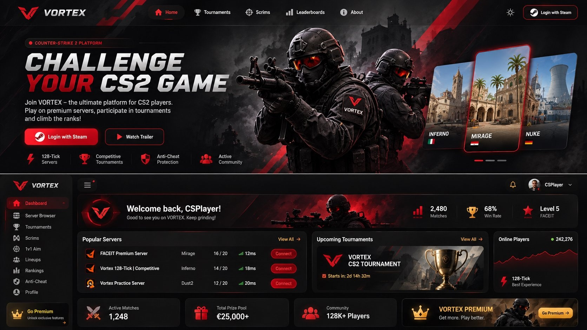

# 🔴 VORTEX GAMING // CS2 Esports Platform

> Next-Generation Counter-Strike 2 Competitive Esports Hub with Obsidian Black & Crimson Red Tactical Identity.



---

## ⚡ Overview

**VORTEX Gaming** is an independent, high-performance web platform built for Counter-Strike 2 players, tournament organizers, and competitive communities. Powered by low-latency CS2 Sub-Tick server routing and automated FACEIT Open API v4 integrations.

- **Independent Project**: Completely separate repository, design language, and architecture from NEXUS.
- **Visual Identity**: Obsidian Onyx Black (`#0A0B0E`), Crimson Red (`#EF4444` / `#DC2626`), and Deep Graphite panels (`#12141C`).
- **Tactical Atmosphere**: Custom Counter-Strike 2 operator visuals, glowing 3D map carousel cards, and esports tournament brackets.

---

## 🚀 Key Features

### 1. Landing Page (Before Login)
- **Cinematic CS2 Tactical Hero Banner**: Atmospheric panoramic battlefield with glowing red volumetric lighting.
- **Dynamic 3D Map Carousel**: Interactive Inferno, Mirage (red neon glow), and Nuke cards with native SVG country flags.
- **One-Click Steam Authentication**: Fast OpenID Steam login flow.
- **Esports Capabilities**: CS2 Sub-Tick matchmaking, competitive tournaments, anti-cheat protection, and active player community.

### 2. Dashboard (After Login)
- **Personalized Gamer Passport**: Live match stats, win rates, and synchronized FACEIT ELO.
- **Dedicated Server Browser**: Real-time ping diagnostics, player capacities, and one-click Steam protocol direct connect (`steam://connect/`).
- **Tournament Circuit**: Automated prize pool distribution, registration tracking, and bracket progression.
- **Kernel Anti-Cheat Monitor**: Ring-0 driver integrity status and hardware UUID verification.
- **VORTEX Premium**: Exclusive competitive perks and priority matchmaking queues.

---

## 🛠️ Tech Stack

- **Framework**: React 18 + TypeScript + Vite
- **Styling**: Tailwind CSS + Custom Crimson/Obsidian theme
- **Icons**: Lucide React + Steam Glyphs + SVG Country Flags
- **Sounds**: Interactive UI Sound Synthesizer (Web Audio API)
- **API**: FACEIT Open API v4 & OpenID Steam Authentication

---

## 💻 Getting Started

### Prerequisites
- Node.js 18+
- npm 9+

### Installation
```bash
# Clone the repository
git clone https://github.com/SGC-bLocKeeR/vortex-gaming.git

# Navigate to project directory
cd vortex-gaming

# Install dependencies
npm install

# Start development server
npm run dev
```

Visit [http://localhost:5175](http://localhost:5175) to view the platform.

---

## 🔒 Security
- All sensitive API keys and secrets are loaded via environment variables (`.env`).
- Never commit production secrets to Git history.

---

© 2026 VORTEX Gaming. All rights reserved. Counter-Strike and CS2 are trademarks of Valve Corporation.
